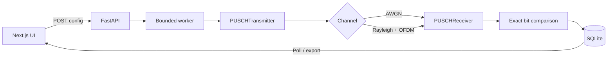

<div align="center">

# ModemScope

### See the signal. Understand the failure.

An interactive 5G NR PUSCH link-level laboratory built with NVIDIA Sionna PHY, FastAPI, PyTorch, and Next.js.

[Launch locally](#quick-start) · [Architecture](#architecture) · [Engineering notes](docs/engineering-notes.md) · [Testing](#testing)


</div>

> [!IMPORTANT]
> ModemScope is a software-based, single-user 5G NR PUSCH link-level simulator. It does **not** produce hardware RF measurements and is not a complete commercial modem or network tester.

## What it does

ModemScope sends real information bits through Sionna's 5G NR `PUSCHTransmitter`, applies AWGN or Rayleigh block fading, decodes with `PUSCHReceiver`, and computes BER/BLER from the resulting bit tensors. The web app turns those experiments into an inspectable engineering record without substituting synthetic results when the PHY fails.

### Implemented features

- Validated QPSK (MCS 5) and 16-QAM (MCS 11) presets
- Quick single-point tests and bounded nine-point Eb/N0 sweeps
- AWGN and Rayleigh block-fading frequency-domain channels
- Exact bit-error and block-error counts, BER, and BLER
- Raw transmitted/received I/Q samples with truthful labeling
- Actual OFDM transmitter resource-grid occupancy and DMRS classification
- Deterministic, evidence-based diagnostics—no LLM or fabricated “AI” analysis
- One-worker background job queue with live progress polling
- Persistent SQLite experiment history and interrupted-job recovery
- JSON and CSV exports of stored measurements
- Responsive landing, laboratory, results, and educational routes
- Reduced-motion behavior, keyboard focus states, errors, loading, and empty states

## Screenshots

Screenshots are generated from the running application after local validation and live in `docs/screenshots/`.

| Product overview | Signal laboratory |
| --- | --- |
|  |  |

## Architecture



See [docs/architecture.md](docs/architecture.md) for process boundaries, lifecycle behavior, and data-integrity decisions.

## Technology stack

| Layer | Technology |
| --- | --- |
| PHY / DSP | NVIDIA Sionna PHY 2.2, PyTorch 2.9, NumPy |
| API | Python 3.11+, FastAPI, Pydantic |
| Jobs / storage | Single-worker executor, SQLite |
| Web | Next.js App Router, React, TypeScript, Framer Motion |
| Visualization | Plotly.js plus an SVG resource-grid renderer |
| Validation | Pytest, Ruff, TypeScript, Next.js production build |

## Quick start

### Requirements

- Python 3.11 or newer
- Node.js 20 or newer
- A machine supported by PyTorch 2.9; an NVIDIA GPU is optional

Sionna PHY and SYS require Python 3.11+ and PyTorch 2.9+. Ubuntu 24.04 is NVIDIA's recommended environment. Windows users should prefer WSL2/Ubuntu for the closest supported setup, although the CPU-only PHY stack can also work in a compatible native Python environment.

### 1. Backend

```bash
python3.11 -m venv .venv
source .venv/bin/activate                 # Windows PowerShell: .venv\Scripts\Activate.ps1
python -m pip install --upgrade pip
python -m pip install -r backend/requirements-dev.txt
cd backend
python -m uvicorn app.main:app --reload --port 8000
```

Check `http://localhost:8000/api/health`. The response must report `sionna_available: true` before experiments can start.

### 2. Frontend

In a second terminal:

```bash
cd frontend
npm install
npm run dev
```

Open `http://localhost:3000`. Copy `.env.example` to `.env.local` only if you need to override the default API or repository URL.

On Windows PowerShell, after dependencies are installed, `./scripts/dev.ps1` launches both development processes. On WSL2/Linux, use `./scripts/dev.sh`.

## Running an experiment

1. Open **Signal Laboratory**.
2. Confirm the status reads **Engine ready**.
3. Select Quick Test or an Eb/N0 Sweep.
4. Choose a validated MCS preset and channel model.
5. Set block workload and seed, then run the simulation.
6. Follow the job stage to the results page.
7. Select any measured Eb/N0 point; inspect exact counts, curves, raw I/Q samples, the resource grid, and diagnostics.
8. Download the stored experiment as JSON or its measurements as CSV.

## How the PHY model works

```text
information bits
  → 5G transport-block CRC / LDPC / rate matching
  → scrambling / QAM / layer mapping
  → DMRS + OFDM resource grid
  → AWGN or normalized Rayleigh block fading
  → channel estimation / detection / soft demapping
  → transport-block decoding
  → information-bit comparison
```

Eb/N0 is converted to noise variance with Sionna's effective bits per symbol, target code rate, and resource-grid overhead. The Rayleigh model is applied by `OFDMChannel`; raw channel-impaired samples are never called “equalized.” Read the [engineering notes](docs/engineering-notes.md) for an interview-oriented explanation.

## Metrics

| Metric | Definition |
| --- | --- |
| BER | Incorrect decoded information bits ÷ transmitted information bits |
| BLER | Transport blocks containing at least one incorrect information bit ÷ transmitted blocks |

When no errors are observed, ModemScope reports the integer sample size and explicitly notes that a finite zero count does not prove a zero true error probability. Zero observations are not replaced with fabricated values for logarithmic charts.

## Testing

From the repository root:

```bash
# Fast unit suite
cd backend
../.venv/bin/python -m pytest -m "not phy"   # Windows: ..\.venv\Scripts\python.exe -m pytest -m "not phy"

# Real Sionna AWGN, Rayleigh, preset, and reproducibility checks
../.venv/bin/python -m pytest tests/test_phy.py -v

# Frontend static and production checks
cd ../frontend
npm run typecheck
npm run build
```

The PHY tests are skipped—not faked—when Sionna is unavailable.

## Limitations

- Single user, SISO, one transmission layer, and four PRBs
- Frequency-domain slot simulation; no time-domain RF waveform or front-end impairment model
- Two deliberately validated MCS presets rather than the full NR MCS space
- Rayleigh block fading is a compact stochastic channel, not a full 3GPP 38.901 mobility scenario
- CPU runs are supported but detailed sweeps can take materially longer
- The first run in a process may include PyTorch/Sionna initialization overhead
- Comparison is performed by opening/exporting stored runs; a dedicated two-run overlay control is a future enhancement
- No authentication or multi-user isolation; designed for local portfolio use

## Roadmap

- Two-run overlay comparison with compatibility checks
- Additional validated MCS presets and configurable PRB allocations
- 3GPP TDL/CDL channel profiles and mobility
- Confidence intervals and adaptive Monte Carlo stopping criteria
- Optional time-domain modeling and synchronization impairments
- Playwright end-to-end coverage across Chromium and mobile breakpoints

## References and acknowledgment

- [Sionna 2.2 5G NR PUSCH tutorial](https://nvlabs.github.io/sionna/phy/tutorials/notebooks/5G_NR_PUSCH.html)
- [Sionna 2.2 PUSCH API](https://nvlabs.github.io/sionna/v2.2.0/phy/api/nr/pusch.html)
- [Sionna installation guide](https://nvlabs.github.io/sionna/installation.html)

ModemScope uses [NVIDIA Sionna](https://github.com/NVlabs/sionna), an open-source library for communication-system research. NVIDIA and Sionna are trademarks of their respective owners; this project is independent and not endorsed by NVIDIA.

## License

MIT — see [LICENSE](LICENSE).
