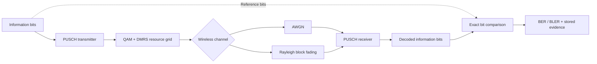

<div align="center">

# ModemScope

### See the signal. Understand the failure.

Explore a 5G NR uplink through physical-layer simulation, signal visualization, and repeatable experiments.

[](#project-status)
[](https://nvlabs.github.io/sionna/v2.2.0/phy/api/nr/pusch.html)
[](#quick-start)
[](#interface)

[Start here](#quick-start) &nbsp; / &nbsp; [Explore the pipeline](#signal-pipeline) &nbsp; / &nbsp; [Check progress](#project-status) &nbsp; / &nbsp; [Engineering notes](docs/engineering-notes.md)

</div>

---

## Wireless systems, made visible.

ModemScope brings a signal laboratory to the browser: configure a PUSCH experiment, submit it to a Python worker, and inspect information-bit errors, I/Q samples, and the OFDM resource grid.

The project connects **NVIDIA Sionna PHY 2.2**, **PyTorch**, **FastAPI**, and **Next.js**. Its engineering objective is simple: every measurement should be traceable to transmitted and decoded information bits, with the configuration and seed stored alongside it.

> [!NOTE]
> This is a project in development. Frontend type checking, lint, and a production build have passed locally. Sionna execution, backend tests, and the full application workflow still need validation. No measured BER/BLER performance or completed end-to-end experiment is claimed here.

## Explore the laboratory

| Configure | Inspect | Investigate |
| :--- | :--- | :--- |
| Quick tests or bounded Eb/N0 sweeps | BER and BLER with integer error counts | Rule-based observations tied to measurements |
| QPSK / 16-QAM MCS preset definitions | Interactive Plotly performance and I/Q charts | Reproducible seeds and saved configurations |
| AWGN / Rayleigh channel implementations | Transmitter resource-grid visualization | SQLite history and JSON / CSV export endpoints |

These features have source implementations; their verification status is listed below.

## Project status

<details open>
<summary><strong>Open the delivery checklist</strong></summary>

| Area | Current evidence | Remaining work |
| :--- | :--- | :--- |
| Landing, laboratory, results, learning pages | Source written; production build passes | Browser and responsive-layout review |
| Frontend quality checks | TypeScript and ESLint pass locally | Resolve minor CSS compatibility warnings |
| Sionna PUSCH engine | Transmitter, receiver, channels, and metrics code written | Execute AWGN and Rayleigh on CPU |
| Presets and reproducibility | Runtime modulation checks and seed handling written | Confirm MCS orders and repeatable counts through PHY tests |
| FastAPI and jobs | Routes, validation, bounded worker, polling written | Exercise success, failure, and restart recovery |
| History and exports | SQLite and export handlers written | Verify persistence and exported contents end to end |
| Scientific validation | Unit and PHY test files written | Run suites and resolve failures |
| Experiment comparison | Not implemented | Compatible two-run overlay |
| Screenshots and browser automation | Not captured / implemented | Capture real UI and add workflow coverage |

The next milestone is **a verified CPU PUSCH experiment from configuration to exported results**.

</details>

## Signal pipeline



<details>
<summary><strong>Follow one transport block through the model</strong></summary>

1. Construct a single-user, single-layer PUSCH configuration with four PRBs.
2. Resolve the MCS through Sionna's transport-block configuration and check its effective modulation order.
3. Generate information bits and transmit them through coding, mapping, and grid stages.
4. Convert Eb/N0 to noise variance using modulation, coding, and resource-grid parameters.
5. Apply AWGN or a Rayleigh block-fading model through `OFDMChannel`.
6. Recover information bits with `PUSCHReceiver`.
7. Compare transmitted and decoded tensors, then store integer counts, rates, samples, and provenance.

The Rayleigh implementation preserves random fading amplitude: per-realization normalization is disabled for the single-tap SISO channel. I/Q sampling uses matching data-resource-element indices from the first slot at each Eb/N0 point.

Read [engineering-notes.md](docs/engineering-notes.md) for QAM, OFDM, channel models, Eb/N0, and interview discussion points.

</details>

## Interface

| Route | Purpose |
| :--- | :--- |
| `/` | Product overview, procedural signal artwork, and labeled illustrative preview |
| `/lab` | Experiment controls, backend health, and stored-run list |
| `/runs/[id]` | Job progress, results, charts, diagnostics, and exports |
| `/learn` | Explanations of the signal pipeline |

A light workspace surrounds dark analysis panels, with restrained motion and responsive layouts. Screenshots will be added after the application is reviewed in a browser.

## Quick start

**Prerequisites:** Python 3.11+, Node.js 22.13+ recommended, and enough disk space for PyTorch and Node dependencies. CPU execution is the current implementation target. NVIDIA recommends Ubuntu 24.04 for Sionna; WSL2 is the preferred Windows development route.

> [!TIP]
> Expand your setup guide below. These commands describe the development workflow; dependency installation and PHY validation are still being completed.

<details>
<summary><strong>Linux / Ubuntu / WSL2 setup</strong></summary>

From the repository root:

```bash
python3.11 -m venv .venv
source .venv/bin/activate
python -m pip install --upgrade pip
python -m pip install -r backend/requirements-dev.txt
cd backend
python -m uvicorn app.main:app --reload --port 8000
```

In a second terminal:

```bash
cd frontend
npm ci
npm run dev
```

</details>

<details>
<summary><strong>Windows PowerShell setup</strong></summary>

From the repository root:

```powershell
py -3.11 -m venv .venv
.\.venv\Scripts\python.exe -m pip install -r backend\requirements-dev.txt
cd backend
..\.venv\Scripts\python.exe -m uvicorn app.main:app --reload --port 8000
```

In a second terminal:

```powershell
cd frontend
npm ci
npm run dev
```

Native Windows dependency compatibility still needs end-to-end confirmation. Use WSL2 if the scientific stack fails to import.

</details>

| Open locally | Address |
| :--- | :--- |
| Application | [localhost:3000](http://localhost:3000) |
| Interactive API documentation | [localhost:8000/docs](http://localhost:8000/docs) |
| Engine health | [localhost:8000/api/health](http://localhost:8000/api/health) |

For custom frontend settings, copy `.env.example` to `frontend/.env.local` and set `NEXT_PUBLIC_API_URL` or `NEXT_PUBLIC_GITHUB_URL`. Backend database overrides must be set in the backend process environment. No paid service or API key is required.

## Your first experiment

After the engine is installed and verified:

1. Open **Signal Laboratory** and check the engine-health indicator.
2. Start with **Quick Test**, **QPSK / MCS 5**, **AWGN**, **8 blocks**, and seed **42**.
3. Submit the job and follow its progress to the results page.
4. Inspect error counts before interpreting rates; a small workload is an exploratory sample.
5. Repeat with an Eb/N0 sweep or a larger workload and export the stored results.

<details>
<summary><strong>What should I look for in the plots?</strong></summary>

- **Performance:** BER and BLER answer different questions. Inspect both the error count and denominator.
- **I/Q samples:** transmitted and received points describe aligned data resource elements. Received samples are raw channel-impaired values, not equalized decisions.
- **Resource grid:** classifications come from the transmitter grid and pilot mask.
- **Diagnostics:** rule-based observations explain the sample; they do not identify hardware defects.

Broad improvement with increasing Eb/N0 is an expected scientific check, not a measured result claimed by this README.

</details>

## Metrics with a denominator

| Metric | Calculation | Interpretation |
| :--- | :--- | :--- |
| BER | `bit_errors / num_bits` | Fraction of decoded information bits that differ |
| BLER | `block_errors / num_blocks` | Fraction of transport blocks containing at least one wrong information bit |
| Runtime | Elapsed engine time | Includes work performed for this run |

**Zero observed errors is a finite-sample observation.** It does not establish a zero true error probability. Logarithmic plotting and zero-value handling remain part of the visualization validation checklist.

## Under the hood

<details>
<summary><strong>Architecture and technology stack</strong></summary>

| Layer | Implementation |
| :--- | :--- |
| PHY | Sionna PHY 2.2.0, PyTorch 2.9, NumPy |
| API | FastAPI, Pydantic, Python 3.11+ |
| Jobs | One heavy worker; bounded submission capacity |
| Storage | SQLite with persisted configuration and results |
| Web | Next.js App Router, React, TypeScript, custom CSS |
| Visualization | Plotly.js, SVG, Framer Motion, Lucide |

The browser submits configuration, polls jobs, and renders API results. The worker performs PHY calculations away from the request loop. SQLite records lifecycle state; startup marks previously active jobs as interrupted.

See [architecture.md](docs/architecture.md) for details.

</details>

<details>
<summary><strong>API explorer</strong></summary>

| Method | Endpoint | Purpose |
| :--- | :--- | :--- |
| `GET` | `/api/health` | Availability, version, device, capabilities |
| `GET` | `/api/config/options` | Presets and parameter limits |
| `POST` | `/api/runs` | Submit an experiment |
| `GET` | `/api/runs` | Read history |
| `GET` | `/api/runs/{id}` | Read status and results |
| `DELETE` | `/api/runs/{id}` | Remove a finished experiment |
| `GET` | `/api/runs/{id}/export.json` | Export a stored record |
| `GET` | `/api/runs/{id}/export.csv` | Export completed measurement rows |

FastAPI serves interactive API documentation at `/docs` when running.

</details>

## Testing

<details>
<summary><strong>Backend and scientific checks</strong></summary>

Activate your virtual environment, then:

```bash
cd backend
# Unit and API tests without the PHY execution suite
python -m pytest tests --ignore=tests/test_phy.py -v

# Real transmitter / channel / receiver tests
python -m pytest tests/test_phy.py -v
```

Test files cover request bounds, exact error counts, diagnostics, storage, API validation, MCS orders, AWGN, Rayleigh, and seed reproducibility. They are written but have not yet passed a complete run. PHY tests skip when Sionna cannot import; a skip does not establish PHY correctness.

</details>

<details>
<summary><strong>Frontend checks</strong></summary>

```bash
cd frontend
npm run typecheck
npm run lint
npm run build
```

All three commands passed locally against Next.js 15.5.28. The build emitted minor CSS compatibility warnings. Browser interaction tests and a complete experiment remain outstanding.

</details>

## Scope and next milestones

This software models a subset of a 5G system: single-user, single-layer, four-PRB PUSCH in the frequency domain. It does not measure RF hardware or implement a full UE, base station, protocol stack, scheduler, or synchronization chain.

- [x] Write the web routes and backend implementation
- [x] Pass frontend TypeScript, lint, and production build
- [ ] Execute and validate AWGN and Rayleigh PUSCH on CPU
- [ ] Pass backend and scientific test suites
- [ ] Verify one complete experiment and its exports
- [ ] Add compatible two-run comparison
- [ ] Review browser accessibility and responsive behavior
- [ ] Capture real screenshots and add browser automation

Future extensions include additional MCS presets, configurable bandwidth, confidence intervals, adaptive stopping, and 3GPP TDL/CDL channels.

## Built on open research

ModemScope acknowledges [NVIDIA Sionna](https://github.com/NVlabs/sionna) and follows the [5G NR PUSCH tutorial](https://nvlabs.github.io/sionna/phy/tutorials/notebooks/5G_NR_PUSCH.html), [versioned PUSCH API](https://nvlabs.github.io/sionna/v2.2.0/phy/api/nr/pusch.html), and [installation guide](https://nvlabs.github.io/sionna/installation.html).

This is an independent project. NVIDIA and Sionna belong to their respective owners.

---

<div align="center">

**ModemScope** &nbsp; / &nbsp; Signals you can inspect. Experiments you can explain.

[Back to top](#modemscope) &nbsp; / &nbsp; [MIT license](LICENSE) &nbsp; / &nbsp; [Engineering notes](docs/engineering-notes.md)

</div>
